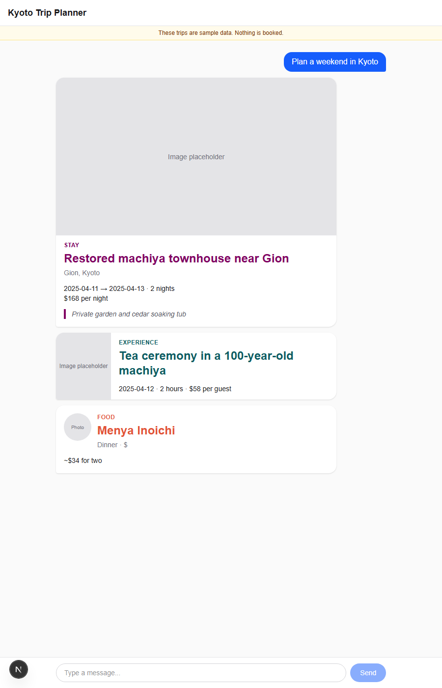
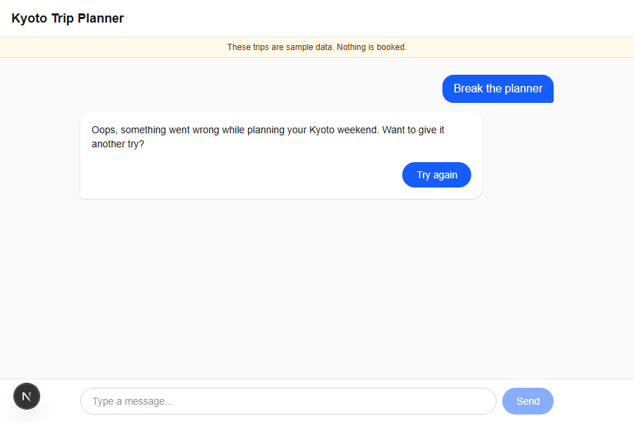

# Kyoto Trip Planner

A chat-style planner for a Kyoto weekend. Sending a message shows a typing indicator, then renders mock stay, experience, and food cards.

**Live link:** https://kyoto-weekend-planner-chat.vercel.app

> **Team note:** This link opens the Kyoto Trip Planner chat in any browser, with no install, login, or setup. All trips are **sample data**; nothing is booked or saved. To try both paths: (1) **Normal:** type any trip request, for example `Plan a weekend in Kyoto`, to see a thinking animation and then a stay, an experience, and a food card. (2) **Failure:** type `Break the planner` and press Enter to see a friendly error with **Try again**, then click it to bring the three cards back. The failure fires once per page load, so refresh to repeat it.

## Run locally

Requires Node 20.9+. Run `npm install && npm run dev`, then open http://localhost:3000.

To fire the error bubble, type `Break the planner` and press Enter. It fails the first time only: the fail flag is a `useRef` inside the chat component, so a page reload clears it and the next try fails again. Click **Try again** to see the three cards.

## Checklist before sharing

- [x] **3 of 3 cards:** one typed request shows a thinking state first, then a stay, an experience, and a food card that each look clearly different. At phone width nothing is cut off and nothing scrolls sideways.
- [x] **0 blank-chat moments:** the chat is never empty: not when the failure happens, not when **Try again** is pressed, and not right after. The friendly message and **Try again** sit inside the assistant's message, and pressing it brings back all three cards.
- [x] **No login:** the link opens in a private/incognito window with no install, login, or configuration. Share only the production `.vercel.app` link, never a preview link (those ask for a Vercel login).
- [x] **Mocked data note:** the page makes clear the trips are sample data and that nothing is booked.

## Placeholder fields

These card fields are filler, not real data:

- **Stay card:** the image area at the top ("Image placeholder").
- **Experience card:** the image strip on the left ("Image placeholder").
- **Food card:** the round thumbnail at the top left ("Photo").

All other fields come from `src/data/mockResponse.ts`.
